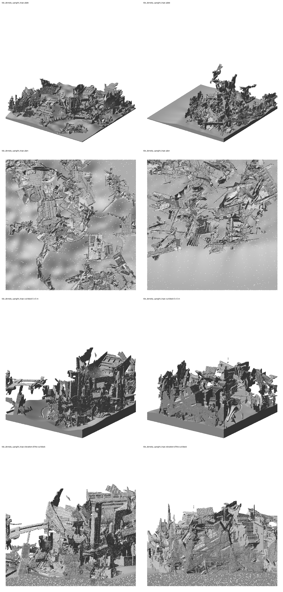
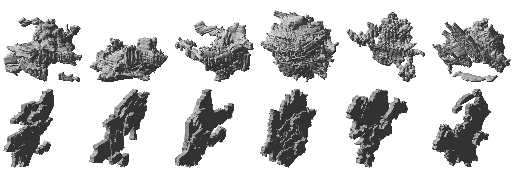
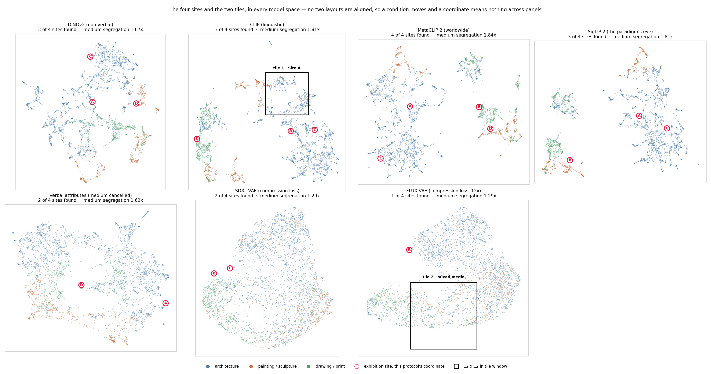
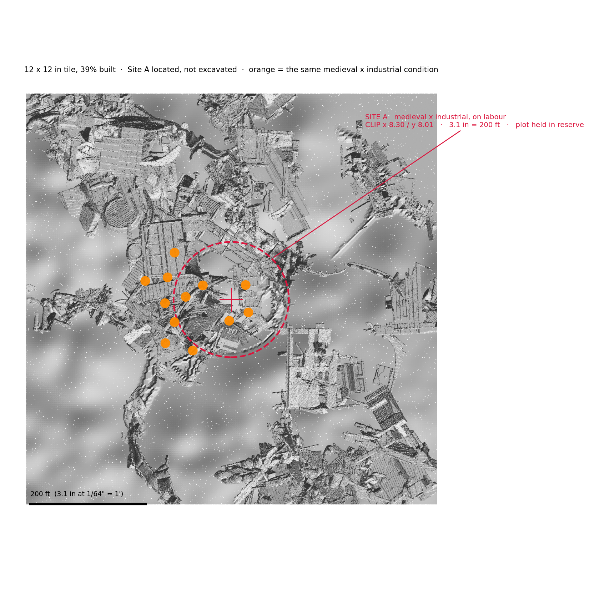

# A site model of a latent space

*What this is, what has been built, and what is worth doing next.*

---

## The idea in one paragraph

A machine-learning model that has looked at 4,475 works of art and architecture
holds an internal opinion about which of them resemble which. Projected to two
dimensions, that opinion is a **map** — a territory with dense districts, borders
and genuine voids. This project treats that map as **ground**. A window of it
becomes a physical architectural site model: the works near each chosen
coordinate are cut into fragments and collaged, each collage is inferred into a
solid, the solids are placed at their map coordinates on terrain derived from the
map's own occupancy, and the whole thing is booleaned into one printable object.

The scale is **1/64" = 1'**, so a 12 × 12 in tile represents **768 × 768 ft** of
imaginary city. The full model is 11 sq ft.

The interesting part is that nothing is composed by hand. The plan of the city
*is* the model's layout. Where a building sits, how big it is, which fragments
it is made of, and where the ground rises are all read off the model rather than
designed.

---

## What has been built

Two tiles, both complete, both printable.

| | tile 1 | tile 2 |
|---|---|---|
| model space | CLIP (a language–image model) | FLUX VAE (an image compressor) |
| centred on | Site A — medieval × industrial | a mixed-media collision |
| volumes | 93 | 77 |
| built plan coverage | 39.4% | 39.3% |
| media in its sources | 94% architecture | **56% arch / 24% painting / 21% drawing** |
| one tile printed | 648 g, 51.4 h | 655 g, 49.6 h |
| 11.1 sq ft would be | 7.2 kg, 24 days | 7.3 kg, 23 days |

*Left column tile 1, right tile 2. Rows: the whole plate, plan, a 5 in cut block,
and the elevation of that cut.*

---

## Four things that were measured, not assumed

Everything below is in [`docs/SITE_MODEL_TILE_TEST.md`](docs/SITE_MODEL_TILE_TEST.md)
with the numbers and the method. They are the useful part of the handover,
because each one cost a day.

**1. The free local model is not good enough, and the reason is specific.**
TripoSR fuses the collage into a single rock: it fills **78%** of the gaps
between fragments. The paid Tripo v3.1 keeps them — gaps-kept 0.42 against 0.22 —
and the difference is the whole character of the object. Raising marching-cubes
resolution does nothing; the limit is the model, not the grid.

*Top row inferred volume, bottom row the alternative: trace each fragment's
outline and extrude it. Same six coordinates. The traced route keeps every
fragment as its own closed solid with its period and terms attached, but its
depth is authored rather than found.*

**2. Which model space you cut from decides what the city is made of.**
CLIP sorts by *medium* before anything else — a work's neighbours share its
category 89% of the time against 49% by chance — so tile 1 landed in an
architecture district and contains **zero drawings**, despite drawings being 17%
of the corpus. The VAEs barely sort by medium at all (1.29× against chance), and
tile 2, cut from one, comes out properly mixed.

*All seven spaces. Colour is category, red rings are the same four conditions in
each. The panels cannot be aligned — every layout is an independent projection,
so a coordinate means nothing across panels and only the condition travels.*

**3. Density was a bug, not a missing feature.** The first build clamped 86 of
95 masses into a 1.8× size range while the underlying data spanned **62×**.
Unclamping it took built coverage from 11.5% to 39%. Nothing was regenerated.

**4. Contrast beats height for topography.** Steepening the terrain curve rather
than raising it gave a more dramatic landscape at **half the material** — because
what reads as drama is slope, not peak height.

---

## Where the site comes from

The tiles are not centred arbitrarily. A "site" here is a **condition**: two
periods that sit at opposite ends of a value axis, both genuinely present on the
same ground. Site A is *medieval × industrial* on the **labour** axis — the hand
and the guild against the machine and the standard.

It ranks **1st of 40 conditions on intensity** and 2nd on how much the different
models agree about who is party to it. And the tile corroborates it
independently: of the 14 collision points the tile picked on its own, **12 carry
the same condition**, clustered 35–151 ft around the centre.

*The orange dots are those 12. The site is a region, not a point.*

The full argument, including a correction to a claim that turned out to be
overstated, is in [`docs/SITE_A_WHY.md`](docs/SITE_A_WHY.md).

---

## Running it

Read [`README.md`](README.md) for install and the full command sequence, and
[`DATA.md`](DATA.md) for what data is here.

**You can clone this and immediately run steps 3, 4 and 5** — volume inference,
terrain and boolean union, bed splitting and slicing — because one tile's 81
assemblages ship with the repository.

**Step 2 needs the corpus**, which is ~4 GB of museum and archive artwork and is
not redistributable. That is the only thing you cannot do from a clone.

The 3D step costs money: about **$19 per tile** through the Tripo API at 20
credits per volume. Nothing is ever sent without an explicit `--spend` flag, and
a resumed run never pays twice for a completed point.

> **This repository is private and needs to stay that way.** The assemblage
> images are composites of third-party artwork.

---

## What is actually open

Ordered by how much they'd change the outcome.

**Is a ruin field the right object?** The masses read as eroded, geological,
archaeological — a ruined citadel rather than a proposal. For a project about
unbuilt architecture that may be exactly right, but it should be a decision. If
the answer is no, the lever is the source compositions, not the 3D model.

**The ground is 85–89% of the printed material.** The city is nearly a rounding
error on the landscape. A smooth height field is a good candidate for CNC foam or
casting, with only the masses printed — a bigger saving than any slicer setting,
and it changes the fabrication strategy for all 11 sq ft.

**Nobody has separated protocol from subject matter.** Tile 2 is flatter than
tile 1, but only 4.5% of their source works overlap, so that could be the model
space *or* the different material. Composing the *same* works in both spaces
would settle it and costs almost nothing.

**Print one and look at it.** Neither tile has been physically printed. Every
number here is from a real slicer, but the object has only ever existed on
screen, and the whole point of the tile was to be cheap enough to hold.

**Two coordinates are missing** from tile 1, refused by Tripo's content
moderation. One of them was pure architecture with no figurative content at all —
so the filter has false positives, and any pipeline that needs a *specific*
coordinate has to plan for that.

---

## The shape of the code

| | |
|---|---|
| `tile_points.py` | pick coordinates in a model space, convert to inches |
| `tile_assemblages.py` | compose one collage per coordinate, with an alpha matte |
| `tile_tripo.py` | volumes via the paid API — spends money, gated |
| `tile_triposr.py` | volumes via a free local model — worse, documented |
| `batch_assemblage_geometry.py` | volumes by tracing and extruding — exact, tagged |
| `tile_model.py` | terrain, placement, boolean union, site marking → STL |
| `tile_print.py` | split to the bed, slice, report real filament and time |
| `tile_map.py`, `tile_contact.py`, `tile_views.py` | looking at it |
| `tile_score.py`, `tile_compare.py`, `tile_protocol_mix.py` | checking it |

Every script writes a JSON sidecar next to its output. That convention is load
bearing — the print exporter, the map overlay and the analysis all read them.
